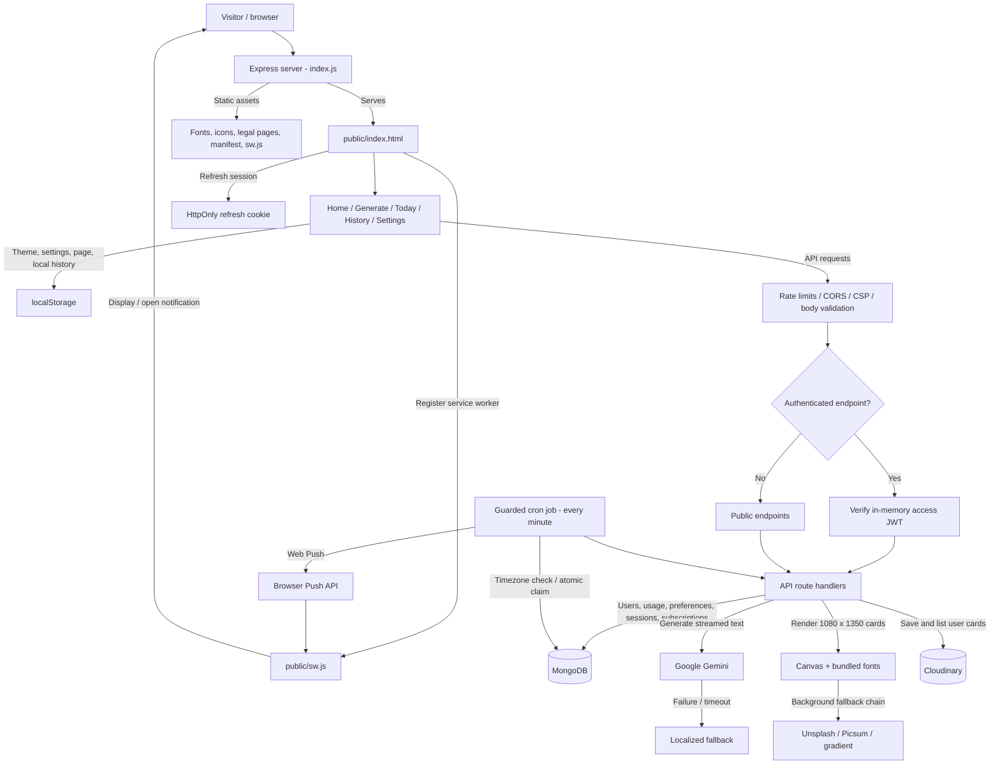
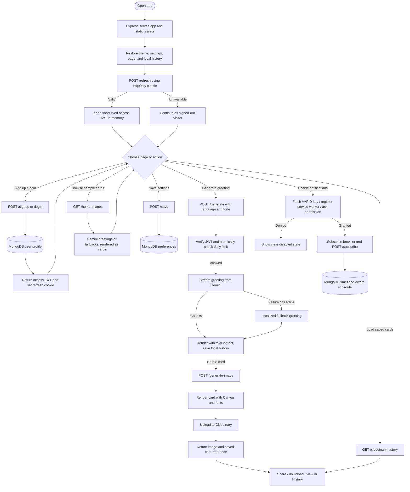
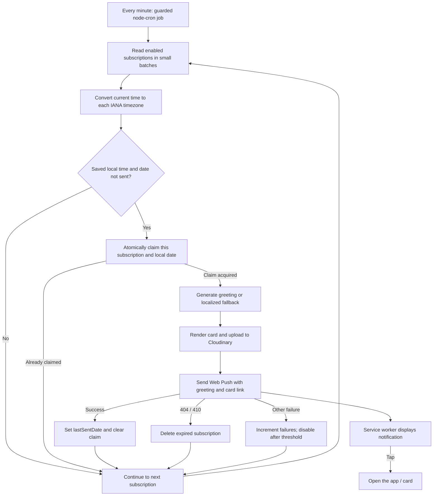

# Good Morning AI - Project Flow

## Application overview

## Main user flows

## Scheduled notification flow

## Key components

- `index.js` and `src/server.js`: validated startup, MongoDB, indexes, scheduler, and graceful shutdown.
- `src/app.js`: Express API, authentication endpoints, validation, rate limiting, CORS/CSP, and static serving.
- `src/models/` and `src/services/`: MongoDB data, session/auth, Gemini, card rendering, Cloudinary, email, and scheduling.
- `public/index.html`: single-page interface and browser-side API/state logic.
- `public/sw.js`: app-shell cache, push display, and notification navigation.
- `fonts/`: bundled Urdu, Devanagari, and Chinese fonts used by the card renderer.
- `tests/`: timezone/duplicate-claim, JWT middleware, and request-validation tests.
